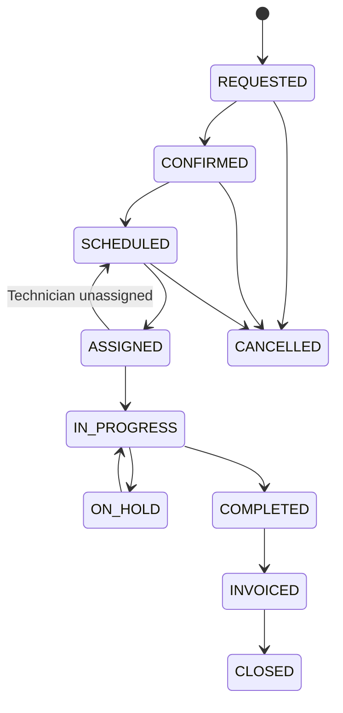

# FieldOps: Complete System Manual, File Architecture & User Guide
**Comprehensive Engineering Reference & Operations Manual**

---

## 📑 Table of Contents
1. [System Overview & Purpose](#1-system-overview--purpose)
2. [Monorepo Directory & Complete File Breakdown](#2-monorepo-directory--complete-file-breakdown)
   - [Root Workspace Files](#root-workspace-files)
   - [Packages: `@fieldops/contracts`](#packages-fieldopscontracts)
   - [Backend API: `apps/api`](#backend-api-appsapi)
   - [Frontend Web Application: `apps/web`](#frontend-web-application-appsweb)
   - [Documentation: `docs/`](#documentation-docs)
3. [Deep-Dive into Core Business Logic](#3-deep-dive-into-core-business-logic)
   - [Technician Conflict & Double-Booking Prevention Engine](#technician-conflict--double-booking-prevention-engine)
   - [Work Order State Lifecycle Engine](#work-order-state-lifecycle-engine)
   - [Atomic Concurrency-Safe Inventory Deduction](#atomic-concurrency-safe-inventory-deduction)
   - [High-Precision Decimal Invoicing Engine](#high-precision-decimal-invoicing-engine)
   - [Argon2id & Tamper-Proof HMAC Session Security](#argon2id--tamper-proof-hmac-session-security)
4. [User Manual by Role (භාවිතා කරන ආකාරය)](#4-user-manual-by-role-භාවිතා-කරන-ආකාරය)
   - [Administrator (`ORG_ADMIN`)](#1-organization-administrator-org_admin)
   - [Dispatcher (`DISPATCHER`)](#2-dispatcher-dispatcher)
   - [Field Technician (`TECHNICIAN`)](#3-field-technician-technician)
   - [Finance Manager (`FINANCE`)](#4-finance-manager-finance)
5. [Complete API Endpoints Directory](#5-complete-api-endpoints-directory)
6. [Development, Execution & Maintenance Commands](#6-development-execution--maintenance-commands)

---

## 1. System Overview & Purpose

**FieldOps** is a production-grade, multi-tenant B2B SaaS platform specifically built for field service operations companies (e.g., Commercial HVAC maintenance, industrial electrical contractors, facility maintenance, and IT hardware support).

### 🎯 Primary Business Problems Solved
- **Eliminating Double-Bookings**: Dispatchers often assign technicians to overlapping jobs accidentally. FieldOps automatically detects schedule conflicts using mathematical interval overlap checks.
- **Strict Multi-Tenancy**: Data between different service companies is strictly isolated at both the middleware and database query layers.
- **Job Execution Disconnect**: Field technicians receive clear mobile-ready checklists and track parts directly from job sites.
- **Preventing Billing Leakage**: Parts used during repair are atomically deducted from inventory and automatically converted into line-item invoices calculated with exact decimal precision (no floating-point rounding errors).

---

## 2. Monorepo Directory & Complete File Breakdown

Below is the complete file-by-file breakdown of every file in the FieldOps codebase and its exact responsibility.

### Root Workspace Files

| File | Exact Purpose & Responsibility |
| :--- | :--- |
| `package.json` | Defines the npm workspaces monorepo (`apps/*`, `packages/*`), root dependencies, and unified scripts (`dev`, `dev:api`, `dev:web`, `build`, `test`, `typecheck`). |
| `tsconfig.base.json` | Shared strict TypeScript compiler configuration (ES2022, bundler resolution, `noUnusedLocals`, `strictNullChecks`) inherited by all apps. |
| `.env` | Active local environment variables containing PostgreSQL database credentials, session secrets, and port settings. |
| `.env.example` | Template environment configuration safe for committing to GitHub without credentials. |
| `docker-compose.yml` | Container definition for running PostgreSQL 16 Alpine locally with persistent health checks and data volumes. |
| `.editorconfig` | Enforces uniform coding conventions (2-space indentation, UTF-8, LF line endings) across IDEs. |
| `.prettierrc` | Code formatting rules (single quotes, trailing commas, 100-character line print width). |
| `.gitignore` | Prevents `node_modules`, build artifacts (`dist`), coverage logs, and private `.env` files from entering source control. |
| `.github/workflows/ci.yml` | GitHub Actions pipeline that automatically installs dependencies, runs typecheck, executes the 33 automated tests, and verifies builds on every git push. |
| `README.md` | Primary GitHub landing page summarizing architecture, quick start instructions, and system highlights. |
| `SYSTEM_MANUAL.md` | This document: comprehensive file architecture and end-user operations manual. |

---

### Packages: `@fieldops/contracts`
Located in `packages/contracts/`. This package guarantees zero contract drift between frontend and backend.

| File | Responsibility |
| :--- | :--- |
| `package.json` | Contract package configuration exporting bundled TypeScript declarations and types to other workspaces. |
| `tsconfig.json` | Inherits from root base config and emits type declarations (`.d.ts`) into `dist/`. |
| `src/enums/index.ts` | Single source of truth for domain enums: `UserRole`, `UserStatus`, `PriorityLevel`, `ServiceRequestStatus`, `WorkOrderStatus`, `InvoiceStatus`, `PaymentMethod`, `PaymentStatus`. |
| `src/api/index.ts` | Standardized API payload contracts: `ApiResponse<T>` and `AuthSessionUser`. |
| `src/schemas/index.ts` | Runtime validation schemas built with **Zod**: `loginSchema`, `registerOrganizationSchema`, `createCustomerSchema`, `createWorkOrderSchema`, `assignTechnicianSchema`, `rescheduleWorkOrderSchema`, `updateWorkOrderStatusSchema`, `createInventoryItemSchema`, `recordPartsUsageSchema`, `generateInvoiceSchema`, `recordPaymentSchema`. |
| `src/index.ts` | Re-exports enums, schemas, and API types. |

---

### Backend API: `apps/api`
Located in `apps/api/`. Node.js Express REST API server using TypeScript and Prisma ORM.

#### 🗄️ Database & Prisma Layer (`apps/api/prisma/`)
| File | Responsibility |
| :--- | :--- |
| `schema.prisma` | Complete relational database schema with **22 models**: `organizations`, `users`, `customers`, `customer_addresses`, `technician_profiles`, `skills`, `technician_skills`, `service_catalog`, `service_requests`, `work_orders`, `work_order_assignments`, `work_order_status_history`, `work_order_checklists`, `checklist_items`, `inventory_items`, `parts_usage`, `invoices`, `invoice_items`, `payments`, `notifications`, `attachments`, `audit_logs`. Uses exact `Decimal(10,2)` types for financial calculations. |
| `seed.ts` | Production-grade demo data seeder. Populates sample organization ("Apex Mechanical"), users (Admin, Dispatcher, Technician), skills, VRF AC services, cold storage customer facility, refrigerant parts, and an active work order. |

#### ⚙️ Configuration & Common Infrastructure (`apps/api/src/common/` & `src/config/`)
| File | Responsibility |
| :--- | :--- |
| `src/config/env.ts` | Strongly-typed environment parser using Zod. Validates `PORT`, `DATABASE_URL`, `SESSION_SECRET`, and `WEB_ORIGIN` at server boot. Crashes immediately if any variable is invalid. |
| `src/common/database/prisma.ts` | Singleton instance of `PrismaClient` with connection pooling and query logging in development mode. |
| `src/common/security/password.ts` | High-security cryptographic password hashing using **Argon2id** (`argon2.hash` with memoryCost $2^{16}$ and 3 iterations) and secure verification. |
| `src/common/security/session.ts` | Tamper-proof session token management using **HMAC SHA-256** signatures with 7-day expiration and timing-safe equality checks. |
| `src/common/errors/app-error.ts` | Domain error class hierarchy: `AppError`, `NotFoundError` (404), `UnauthorizedError` (401), `ForbiddenError` (403), `BadRequestError` (400), `ConflictError` (409), and `ValidationError` (422). |
| `src/common/http/response.ts` | Standardized JSON response helpers (`sendSuccess`, `sendCreated`, `sendError`). |
| `src/common/logging/logger.ts` | Structured timestamped console logging utility. |

#### 🛡️ Middleware (`apps/api/src/middleware/`)
| File | Responsibility |
| :--- | :--- |
| `auth.middleware.ts` | Handles session extraction from cookies or Bearer headers (`authenticateSession`), enforces authenticated session presence (`requireAuth`), checks user roles (`requireRole`), and ensures multi-tenant isolation (`enforceTenant`). |
| `validate.middleware.ts` | Validates incoming `req.body`, `req.query`, and `req.params` against Zod schemas before hitting controllers. |
| `error.middleware.ts` | Global express error handler. Traps domain errors, Zod validation issues, and database errors, converting them into clean JSON without leaking stack traces in production. |

#### 📦 Business Modules (`apps/api/src/modules/`)
| Module Directory | Contained Files & Purpose |
| :--- | :--- |
| `modules/health/` | `health.controller.ts`, `health.routes.ts`: Server uptime and health check endpoints (`/health` and `/api/v1/health`). |
| `modules/auth/` | `auth.repository.ts`, `auth.service.ts`, `auth.controller.ts`, `auth.routes.ts`: User login, atomic organization onboarding, cookie setting, session revocation (`/logout`), and current profile (`/me`). |
| `modules/customers/` | `customers.repository.ts`, `customers.service.ts`, `customers.controller.ts`, `customers.routes.ts`: Multi-tenant customer accounts and service facility address management. |
| `modules/service-catalog/` | `service-catalog.repository.ts`, `service-catalog.service.ts`, `service-catalog.controller.ts`, `service-catalog.routes.ts`: Predefined standard service offerings, durations, and base prices. |
| `modules/service-requests/` | `service-requests.repository.ts`, `service-requests.service.ts`, `service-requests.controller.ts`, `service-requests.routes.ts`: Customer service intake, priority assignment, and status triage. |
| `modules/work-orders/` | `work-orders.state-machine.ts`, `work-orders.repository.ts`, `work-orders.service.ts`, `work-orders.controller.ts`, `work-orders.routes.ts`: Work order lifecycle state machine, technician dispatch, schedule conflict detection, and status history logging. |
| `modules/inventory/` | `inventory.repository.ts`, `inventory.service.ts`, `inventory.controller.ts`, `inventory.routes.ts`: Parts catalog, stock quantity tracking, reorder alerts, and atomic stock decrement on jobs. |
| `modules/invoices/` | `invoices.repository.ts`, `invoices.service.ts`, `invoices.controller.ts`, `invoices.routes.ts`: Decimal-accurate invoice generation combining labor and parts, and payment recording. |
| `modules/checklists/` | `checklists.routes.ts`: Dynamic job execution checklists and interactive item completion toggling. |
| `modules/reports/` | `reports.service.ts`, `reports.controller.ts`, `reports.routes.ts`: Real-time operational dispatch reports, revenue summaries, and low-stock inventory alerts. |
| `src/app.ts` | Express application factory assembling Helmet, CORS, Cookie-Parser, JSON parsers, all API routers, and error middleware. |
| `src/server.ts` | Server bootstrap script that initiates the HTTP listener on port 4000 and registers graceful shutdown signals (`SIGTERM`, `SIGINT`). |

#### 🧪 Automated Test Suite (`apps/api/tests/`)
| Test File | Verified Functionality |
| :--- | :--- |
| `tests/integration/health.test.ts` | Validates API connectivity, 200 OK responses, uptime, and 404 handler. |
| `tests/unit/security.test.ts` | Tests Argon2id hashing/verification and HMAC session token signature verification and tamper rejection. |
| `tests/unit/authorization.test.ts` | Tests role checking (RBAC), tenant boundary enforcement, and unauthorized access denials. |
| `tests/unit/customers-and-requests.test.ts` | Tests duplicate customer prevention, cross-tenant isolation, and service request status transitions. |
| `tests/unit/scheduling-and-state-machine.test.ts` | Tests legal vs illegal state machine transitions, invalid date windows, and overlapping technician double-booking prevention. |
| `tests/unit/inventory-and-invoicing.test.ts` | Tests stock deduction validation, non-completed work order invoice rejection, duplicate invoice prevention, and exact line-item math. |

---

### Frontend Web Application: `apps/web`
Located in `apps/web/`. Single Page Application engineered with React 18, TypeScript, Vite, and Tailwind CSS.

| File | Exact Purpose & Responsibility |
| :--- | :--- |
| `package.json` | Web application package configuration (Vite, React 18, TanStack Query, Lucide Icons, Tailwind CSS). |
| `vite.config.ts` | Vite configuration with `@/` path alias and automatic backend reverse proxy (`/api` $\rightarrow$ `http://localhost:4000`). |
| `tailwind.config.js` | Design system configuration with custom corporate brand color palettes. |
| `postcss.config.js` | Tailwind and Autoprefixer PostCSS integration. |
| `index.html` | HTML entry point mounting `<div id="root">`. |
| `src/main.tsx` | React 18 DOM root initialization with StrictMode. |
| `src/styles/index.css` | Global Tailwind CSS directives (`@tailwind base; components; utilities;`). |
| `src/app/query-client.ts` | Configures TanStack Query with standard retry count (1) and 5-minute cache `staleTime`. |
| `src/app/providers.tsx` | App-wide provider wrapper injecting TanStack Query client. |
| `src/app/router.tsx` | Client-side routing configuration using React Router (`/login`, `/`, `/requests`, `/work-orders`, `/dispatch`, `/technicians`, `/customers`, `/inventory`, `/invoices`, `/settings`). |
| `src/features/auth/AuthContext.tsx` | Provides `useAuth()`, session verification with `/api/v1/auth/me`, login, and logout functions. |
| `src/features/auth/components/ProtectedRoute.tsx` | Route guard that redirects unauthenticated users to `/login`. |
| `src/features/auth/pages/LoginPage.tsx` | Corporate login screen with password visibility, error alerts, and one-click demo role login pills (`Admin`, `Dispatcher`, `Technician`). |
| `src/components/layout/AppLayout.tsx` | Core responsive application shell with dynamic role-based sidebar navigation, user role badges, one-click role switcher, and prominent **Logout** buttons in header and sidebar. |
| `src/features/dashboard/pages/DashboardOverviewPage.tsx` | Routes to role-specific dashboard views (`AdminDashboard`, `DispatcherDashboard`, `TechnicianDashboard`, `FinanceDashboard`). |
| `src/features/dashboard/components/AdminDashboard.tsx` | Operations summary with fleet work orders, revenue KPIs, lifecycle pipeline, and system status. |
| `src/features/dashboard/components/DispatcherDashboard.tsx` | Dispatch operations center with emergency triage alerts, unassigned job counters, and technician availability statuses. |
| `src/features/dashboard/components/TechnicianDashboard.tsx` | Technician workspace featuring active work order, execution buttons (`Start`, `Complete`, `Parts`), and diagnostic checklists. |
| `src/features/dashboard/components/FinanceDashboard.tsx` | Billing and revenue dashboard with total invoiced/settled metrics, outstanding balances, and completed work orders. |
| `src/features/service-requests/pages/ServiceRequestsPage.tsx` | Customer service intake tickets, priority triage, and dispatching to work orders. |
| `src/features/work-orders/pages/WorkOrdersPage.tsx` | Work Orders directory with real-time status filtering (Scheduled, Assigned, In Progress, Completed), priority badges, and job cards. |
| `src/features/scheduling/pages/DispatchBoardPage.tsx` | Visual technician scheduling board displaying daily technician columns, certified skills, and appointment blocks. |
| `src/features/technicians/pages/TechniciansPage.tsx` | Technician roster, skill qualifications, hourly rates, and real-time availability toggles. |
| `src/features/customers/pages/CustomersPage.tsx` | Customer fleet directory showing company accounts, facility addresses, and active work orders. |
| `src/features/inventory/pages/InventoryPage.tsx` | Parts inventory ledger displaying SKU, quantity on hand, unit cost, billing price, and automated reorder alerts. |
| `src/features/invoices/pages/InvoicesPage.tsx` | Itemized invoice records, payment settlement ledger, and financial status tracking. |
| `src/features/settings/pages/SettingsPage.tsx` | Multi-tenant organization settings, strict double-booking engine toggle, tax rates, and security overview. |

---

### Documentation: `docs/`
Located in `docs/`.
- `docs/architecture/system-architecture.md`: Visual Mermaid architecture diagram of the full-stack system.
- `docs/architecture/database-erd.md`: Entity-relationship diagram showing all 22 database tables and relationships.
- `docs/architecture/adr/001-monorepo-and-tech-stack.md`: Architecture Decision Record detailing why Monorepo, Prisma, Express, and Vite were chosen.
- `docs/requirements/problem-statement.md`: Problem statement and business solution analysis.
- `docs/api/openapi.yaml`: Full OpenAPI 3.0 REST specification (importable directly into Postman or Swagger).

---

## 3. Deep-Dive into Core Business Logic

### Technician Conflict & Double-Booking Prevention Engine
A common failure in field dispatch software is assigning a technician to two locations simultaneously. FieldOps prevents this through mathematical interval intersection:

Two time intervals $[S_1, E_1]$ and $[S_2, E_2]$ overlap if and only if:
$$S_{\text{existing}} < E_{\text{new}} \quad \text{AND} \quad E_{\text{existing}} > S_{\text{new}}$$

In [`WorkOrdersRepository.findConflictingAssignments`](file:///c:/Users/3535/Documents/sithum/FieldOps/apps/api/src/modules/work-orders/work-orders.repository.ts#L78-L107), this query is executed across all active work orders (excluding `COMPLETED`, `CLOSED`, and `CANCELLED`). If any overlapping record is found, the service halts execution and throws a `ConflictError(409)`.

### Work Order State Lifecycle Engine
Frontend applications should never arbitrarily set a job's status. FieldOps enforces a validated state lifecycle inside [`work-orders.state-machine.ts`](file:///c:/Users/3535/Documents/sithum/FieldOps/apps/api/src/modules/work-orders/work-orders.state-machine.ts):



Every transition automatically creates an immutable audit trail entry in the `work_order_status_history` table recording:
- `oldStatus` and `newStatus`
- `changedById` (who triggered it)
- `reason` (why the change occurred)
- `createdAt` timestamp

### Atomic Concurrency-Safe Inventory Deduction
When a technician records parts used on a work order:
1. Inside a PostgreSQL transaction (`prisma.$transaction`), the current stock level is verified (`quantityOnHand >= requestedQuantity`).
2. If stock is insufficient, a `BadRequestError(400)` is raised and the transaction rolls back.
3. If stock is sufficient, `quantityOnHand` is decremented atomically, and a `parts_usage` record is created with the exact unit price snapshot.

### High-Precision Decimal Invoicing Engine
JavaScript's native floating-point numbers (`0.1 + 0.2 === 0.30000000000000004`) cause financial reconciliation discrepancies. FieldOps stores all money fields in PostgreSQL as `DECIMAL(10,2)` and calculates totals using Prisma's `Decimal` arithmetic:

$$\text{Subtotal} = \text{Base Labor Fee} + \sum (\text{Part Quantity} \times \text{Part Unit Price})$$
$$\text{Tax} = \text{Subtotal} \times \frac{\text{Tax Rate}}{100}$$
$$\text{Total} = \text{Subtotal} + \text{Tax}$$

Invoices can only be created once a job reaches `COMPLETED` status, and duplicate invoices for the same work order are strictly rejected.

### Argon2id & Tamper-Proof HMAC Session Security
1. **Passwords**: Hashed with Argon2id using 64MB memory cost. Rainbow tables and GPU brute-force attacks are mathematically impractical.
2. **Session Cookies**: Serialized session payloads are signed using HMAC-SHA256 with the server's `SESSION_SECRET`. If a client tampers with any byte of the payload or signature, `crypto.timingSafeEqual` comparison rejects it immediately.

---

## 4. User Manual by Role (භාවිතා කරන ආකාරය)

### 1. Organization Administrator (`ORG_ADMIN`)
**වගකීම**: ආයතනයේ users, service catalog, settings සහ reports කළමනාකරණය.
- **Login වීම**: Default email `admin@apexservices.lk` සහ Password `Password123!` භාවිතයෙන් system එකට පිවිසෙන්න.
- **Service Catalog එක සැකසීම**: ආයතනය ලබාදෙන සේවාවන් (උදා: "Commercial AC Maintenance", "Chiller Diagnostics"), ඒ සඳහා ගතවන default කාලය සහ base price එක ඇතුළත් කරන්න.
- **Reports පරීක්ෂාව**: `/api/v1/reports/operations` මඟින් මුළු revenue, active work orders ගණන සහ low stock alerts එකවර බලාගන්න.

### 2. Dispatcher (`DISPATCHER`)
**වගකීම**: Requests පරීක්ෂා කර, වැඩ නියමිත වේලාවන්ට technicians ලාට assign කිරීම.
- **Work Orders බැලීම**: Dashboard එකේ හෝ Work Orders පිටුවේ ඇති requests පරීක්ෂා කරන්න.
- **Technician Scheduling**: Dispatch Board එකෙන් technicians ලාගේ ලබාගත හැකි වේලාවන් (availability) බලා job එක assign කරන්න.
  - *සටහන*: Technician කෙනෙකුට එකම වේලාවේ job දෙකක් assign කිරීමට උත්සාහ කළහොත් system එක ස්වයංක්‍රීයව **Conflict Error** එකක් ලබාදී එය වළක්වයි.
- **Status යාවත්කාලීන කිරීම**: Job එකක් Cancel කිරීමට හෝ Reschedule කිරීමට අවශ්‍ය නම් අදාළ action එක තෝරන්න.

### 3. Field Technician (`TECHNICIAN`)
**වගකීම**: අදාළ ස්ථානයට ගොස් job එක ක්‍රියාත්මක කිරීම, checklists සම්පූර්ණ කිරීම සහ parts සටහන් කිරීම.
- **Job එක Start කිරීම**: වැඩබිමට ළඟා වූ පසු `POST /work-orders/:id/start` මඟින් status එක `IN_PROGRESS` බවට පත් කරන්න.
- **Checklist සම්පූර්ණ කිරීම**: Job එකට අදාළ checklist items එකින් එක සම්පූර්ණ කර toggle කරන්න (`/checklists/items/:itemId/toggle`).
- **භාවිතා කළ Parts සටහන් කිරීම**: Job එක සඳහා භාවිත කළ spare parts (උදා: Capacitors, Refrigerant) `POST /work-orders/:id/parts` මඟින් ඇතුළත් කරන්න. එවිට inventory එකෙන් stock ස්වයංක්‍රීයව අඩුවේ.
- **Job එක Complete කිරීම**: සියලුම වැඩ අවසන් වූ පසු `POST /work-orders/:id/complete` ක්ලික් කර job එක අවසන් කරන්න.

### 4. Finance Manager (`FINANCE`)
**වගකීම**: අවසන් වූ jobs සඳහා invoices නිකුත් කිරීම සහ payments සටහන් කිරීම.
- **Invoice Generate කිරීම**: `COMPLETED` වූ work order එකක් සඳහා `POST /work-orders/:id/invoice` call කරන්න. එවිට Service Base Price එක සහ භාවිතා කළ Parts වල මිල ගණන් එකතු කර exact tax සහිත invoice එකක් සෑදේ.
- **Payment සටහන් කිරීම**: Customer ගෙවීම් කළ පසු `POST /invoices/:id/payments` මඟින් payment එක record කරන්න. Invoice එක fully settle වූ වහාම work order එක `CLOSED` status එකට යාවත්කාලීන වේ.

---

## 5. Complete API Endpoints Directory

All versioned API endpoints are mounted under base prefix `/api/v1`:

| Method | Endpoint | Allowed Roles | Description |
| :--- | :--- | :--- | :--- |
| `GET` | `/health` | Public | System health check and uptime. |
| `POST` | `/api/v1/auth/login` | Public | Authenticates user and issues HTTP-only session cookie. |
| `POST` | `/api/v1/auth/register-organization` | Public | Atomically creates a new organization and admin user. |
| `POST` | `/api/v1/auth/logout` | Authenticated | Clears the session cookie. |
| `GET` | `/api/v1/auth/me` | Authenticated | Returns current authenticated user and organization. |
| `GET` | `/api/v1/customers` | Admin, Dispatcher, Finance | Lists all customers belonging to the tenant. |
| `POST` | `/api/v1/customers` | Admin, Dispatcher | Registers a customer profile and primary service facility address. |
| `GET` | `/api/v1/customers/:id` | Admin, Dispatcher, Finance | Fetches customer details with recent work order history. |
| `GET` | `/api/v1/service-catalog` | Authenticated | Lists standard service offerings and base prices. |
| `POST` | `/api/v1/service-catalog` | Admin, Dispatcher | Creates a new catalog item. |
| `GET` | `/api/v1/service-requests` | Authenticated | Lists incoming customer service requests. |
| `POST` | `/api/v1/service-requests` | Authenticated | Creates a new customer service request. |
| `PATCH`| `/api/v1/service-requests/:id/status`| Admin, Dispatcher | Triages request status (`PENDING` $\rightarrow$ `REVIEWED` $\rightarrow$ `CONVERTED`). |
| `GET` | `/api/v1/work-orders` | Authenticated | Lists work orders with optional status/priority filtering. |
| `POST` | `/api/v1/work-orders` | Admin, Dispatcher | Creates a new work order. |
| `GET` | `/api/v1/work-orders/:id` | Authenticated | Retrieves full job details, checklists, parts, and history. |
| `POST` | `/api/v1/work-orders/:id/assign` | Admin, Dispatcher | Assigns a technician with double-booking conflict prevention. |
| `POST` | `/api/v1/work-orders/:id/reschedule`| Admin, Dispatcher | Reschedules appointment with conflict verification. |
| `PATCH`| `/api/v1/work-orders/:id/status` | Authenticated | Transitions job status validating finite state machine rules. |
| `POST` | `/api/v1/work-orders/:id/start` | Admin, Dispatcher, Tech | Starts job execution (`IN_PROGRESS`). |
| `POST` | `/api/v1/work-orders/:id/complete` | Admin, Dispatcher, Tech | Completes job execution (`COMPLETED`). |
| `POST` | `/api/v1/work-orders/:id/checklists`| Admin, Dispatcher, Tech | Adds dynamic execution checklist. |
| `PATCH`| `/api/v1/checklists/items/:itemId/toggle`| Admin, Dispatcher, Tech| Toggles checklist item completed status. |
| `GET` | `/api/v1/inventory` | Authenticated | Lists parts inventory with low-stock reorder indicators. |
| `POST` | `/api/v1/inventory` | Admin, Dispatcher | Adds a new inventory part SKU. |
| `POST` | `/api/v1/work-orders/:id/parts` | Admin, Dispatcher, Tech | Records parts used with atomic stock deduction. |
| `GET` | `/api/v1/invoices` | Admin, Dispatcher, Finance | Lists billing invoices. |
| `GET` | `/api/v1/invoices/:id` | Admin, Dispatcher, Finance, Customer | Fetches itemized invoice details. |
| `POST` | `/api/v1/work-orders/:id/invoice` | Admin, Dispatcher, Finance | Generates itemized invoice from completed work order. |
| `POST` | `/api/v1/invoices/:id/payments` | Admin, Finance, Customer | Records invoice payment and settles balance. |
| `GET` | `/api/v1/reports/operations` | Admin, Dispatcher, Finance | Live operations, financial settlements, and inventory metrics. |

---

## 6. Development, Execution & Maintenance Commands

### Running Locally with PostgreSQL
To start both servers locally:

```powershell
# 1. Start the Backend API (Port 4000)
npm.cmd run dev:api

# 2. In a second terminal, start the Frontend Web App (Port 5173)
npm.cmd run dev:web
```

### Database Management Commands
```powershell
# Push schema changes to PostgreSQL
npx.cmd prisma db push --schema=apps/api/prisma/schema.prisma

# Populate database with demo seed data
npm.cmd run prisma:seed --workspace=@fieldops/api

# Launch Prisma Studio (Visual Web Database Explorer)
npx.cmd prisma studio --schema=apps/api/prisma/schema.prisma
```

### Verification & Testing
```powershell
# Run the 33 automated unit and integration tests
npm.cmd run test

# Run strict TypeScript typecheck across all 3 workspaces
npm.cmd run typecheck

# Build all packages for production
npm.cmd run build
```

