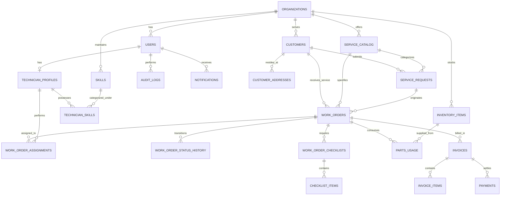

# Database Entity-Relationship Specification

## Key Relational Invariants
- An `Organization` is the top-level tenancy boundary.
- A `Customer` and their `CustomerAddress` belong to an `Organization`.
- A `WorkOrder` assignment checks for overlaps across `WorkOrderAssignment` join with scheduled intervals.
- `PartsUsage` deducts from `InventoryItem.quantityOnHand` within an atomic database transaction.
- `Invoices` reference a `WorkOrder` and compute line item totals using exact decimal arithmetic.

