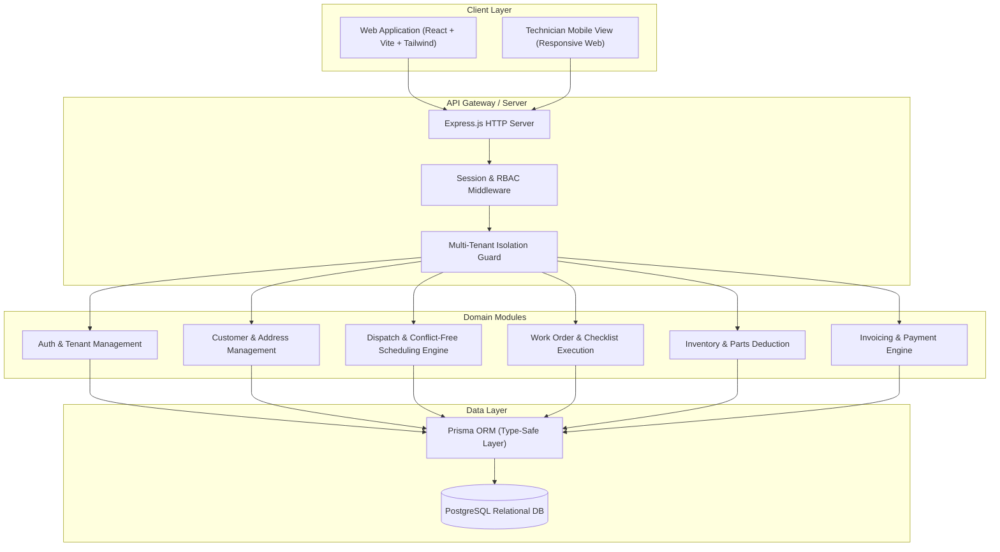

# FieldOps System Architecture

## Security & Architecture Principles
1. **Multi-Tenancy Enforced at Database Queries**: Queries strictly filter by `organization_id` or join through parent ownership relations.
2. **Defensive Status Transitions**: State machine transitions for Work Orders are strictly validated by domain services.
3. **Financial Precision**: All monetary values are handled using `DECIMAL(10,2)` in PostgreSQL and processed as precise Decimal objects in backend services.
4. **Shared Type Contracts**: The `@fieldops/contracts` workspace ensures contract consistency between frontend forms, API DTOs, and schema validations.

